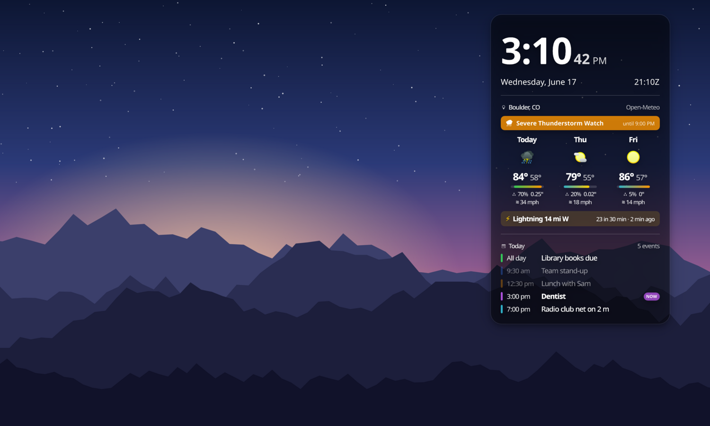

# SimpleKDEDeskWidget

A KDE Plasma 6 desktop widget: a big clock, a three-day forecast, US weather alerts, nearby lightning and today's calendar. It's the Plasma version of [SimpleDesktopWidget](https://github.com/kingsqueak/SimpleDesktopWidget) for macOS.



<sub>Sample data: the town, forecast, alert, lightning and events in the screenshot are made up.</sub>

- **Clock**: 12 or 24 hour, seconds, date, UTC (Zulu) time.
- **Forecast**: [Open-Meteo](https://open-meteo.com) (free, no key). Shows high and low, a temperature-range bar, chance and amount of precipitation, and wind gusts. Refreshes every 30 minutes.
- **Alerts**: active National Weather Service alerts for your location, one banner for each type of alert (US only). Checked every 5 minutes.
- **Lightning**: live strikes from the volunteer [Blitzortung.org](https://www.blitzortung.org) network. The widget filters strikes on your computer by the radius you choose, so your location is never sent anywhere. Off by default. Don't use it for safety decisions.
- **Calendar**: today's events from ICS feed URLs, including recurring events. Finished events fade out, and the one happening now is marked NOW.
- **Appearance**: font, clock and text weight, text colour, text outline, drop shadow, card colour and opacity. Everything scales with the widget's width.

## Requirements

- **KDE Plasma 6.0 or later.** Developed on Kubuntu 26.04 with Plasma 6.6.
- **For lightning:** the QtWebSockets QML module. A standard Plasma desktop doesn't always include it. Without it, everything else works and the widget shows a note where the lightning line would be.
- **For the calendar:** Python 3 with the `icalendar` and `recurring-ical-events` libraries. Without them, the calendar section shows a note saying so.

On Debian, Ubuntu or Kubuntu, this installs all three:

```sh
sudo apt install qml6-module-qtwebsockets python3-icalendar python3-recurring-ical-events
```

On other distributions, install the equivalent packages: the Qt 6 WebSockets QML module and the two Python libraries (both are also on PyPI).

The clock, forecast and alerts need nothing beyond Plasma.

## Install

1. Install the packages listed under Requirements.
2. Download `SimpleKDEDeskWidget-<version>.plasmoid` from the [latest release](https://github.com/kingsqueak/SimpleKDEDeskWidget/releases/latest).
3. Install it, either way works:
   - Run `kpackagetool6 -t Plasma/Applet -i SimpleKDEDeskWidget-<version>.plasmoid`.
   - Or right-click the desktop, choose **Add or Manage Widgets…**, click **Get New…**, choose **Install Widget From Local File…**, and pick the file.
4. Right-click the desktop, choose **Add or Manage Widgets…**, and drag **SimpleKDEDeskWidget** onto the desktop.

To resize it, enter Edit Mode and drag a corner. To change its settings, right-click it and choose **Configure SimpleKDEDeskWidget…**.

The widget installs for your user only, into `~/.local/share/plasma/plasmoids/`; it doesn't need root.

To upgrade, run `kpackagetool6 -t Plasma/Applet -u SimpleKDEDeskWidget-<new version>.plasmoid`, then log out and back in, or restart Plasma with `systemctl --user restart plasma-plasmashell`. Plasma keeps running the old version until it restarts. Your settings are kept.

To uninstall, run `kpackagetool6 -t Plasma/Applet -r com.kingsqueak.simplekdedeskwidget`.

### From source

```sh
git clone https://github.com/kingsqueak/SimpleKDEDeskWidget.git
cd SimpleKDEDeskWidget
./install.sh            # install or upgrade into ~/.local/share/plasma/plasmoids
./install.sh restart    # same, then restart plasmashell so the desktop loads the new code
./install.sh test       # try it in plasmoidviewer (package plasma-sdk) without installing
./install.sh remove
```

## Settings

- **Weather → Find place** searches Open-Meteo's place list. Small towns sometimes don't appear; if yours doesn't, type the latitude and longitude yourself.
- **Calendar → ICS feeds**: put one URL per line. You can add a colour after the URL, like `https://…/basic.ics #34c759`. `webcal://` links work too.
  - Google Calendar: open the calendar's settings and copy **Secret address in iCal format**.
  - iCloud: share the calendar as a public calendar and copy the link.
  - Treat these URLs like passwords: anyone who has one can read the calendar. Plasma keeps them in `~/.config/plasma-org.kde.plasma.desktop-appletsrc`.
  - Feeds are fetched every 15 minutes. The last good copy of each is kept in `~/.cache/simplekdedeskwidget/`, so the list stays filled if the network drops.

## Differences from the Mac version

- Moving and resizing use Plasma's own Edit Mode instead of the Mac version's Configure mode.
- There's no frosted glass. The **Use the Plasma theme background** option gives you the theme's panel background instead.
- Desktop icons aren't moved out of the widget's way. Plasma keeps widgets and folder-view icons on separate layers.
- The calendar reads ICS feeds instead of the system calendar (EventKit on the Mac).

## Building a release

The version is in `VERSION`. `./build.sh` stamps that version into `package/metadata.json` and writes `dist/SimpleKDEDeskWidget-<version>.plasmoid`, which is a zip of `package/`.

`scripts/make-screenshot.py` makes the README screenshot. It renders the widget with made-up sample data through `scripts/snapshot.qml` on a drawn wallpaper. It needs `qml6` and a running desktop session.

## How it works

Everything is QML and JavaScript running inside plasmashell:

- Open-Meteo and NWS are fetched with `XMLHttpRequest`.
- Blitzortung comes in over a `QtWebSockets` connection. It lives in `LightningSocket.qml`, loaded through a Loader, so a missing module can only disable lightning. Its messages are LZW-packed JSON, decoded in `contents/code/logic.js`.
- Calendar feeds go through `contents/code/sdkw_calendar.py`, run with Plasma's executable data engine. It prints today's events as JSON.

## License

GPL-3.0-or-later. See [LICENSE](LICENSE).
